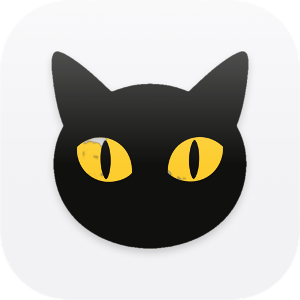

<h1 align="center">FLOW.</h1>

FLOW makes everyday intentions easier to capture, start, remember, and gently resume.

## Ideas to try

Each opens Lamp with a copy of FLOW. and that change, ready to send:

- [Break big intentions into tiny first steps](https://lamp.dev/?repo=https://github.com/everaldo-coelho/flow&from=readme&ask=Break%20big%20intentions%20into%20tiny%20first%20steps)
- [Suggest intentions that fit my energy today](https://lamp.dev/?repo=https://github.com/everaldo-coelho/flow&from=readme&ask=Suggest%20intentions%20that%20fit%20my%20energy%20today)
- [Show which intentions I keep putting off](https://lamp.dev/?repo=https://github.com/everaldo-coelho/flow&from=readme&ask=Show%20which%20intentions%20I%20keep%20putting%20off)

## Open it in Lamp

[Lamp](https://lamp.dev) is a Mac app that builds apps from a description and changes them as you ask. [Open FLOW. in Lamp](https://lamp.dev/?repo=https://github.com/everaldo-coelho/flow&from=readme) for a copy of your own, to use and to change as you like, with the credits below kept. Or, in Lamp, choose File → Open from GitHub… and paste `https://github.com/everaldo-coelho/flow`.

## Building it

Lamp builds this kind of app: it needs Xcode and signing on your Mac, which Lamp sets up. Open it in Lamp, above.

21 pictures made with AI, each marked as such in the file itself: `Mac/Assets/moss.png`, `Mac/Assets/rabbit.png`, `Mac/Assets/cat.png`, `Mac/Assets/fox.png`, `Mac/Assets/fox-animations.png`, `Mac/Assets/cat-animations.png`, `Mac/Assets/rabbit-animations.png`, `Mac/Assets/moss-animations.png`, `Mac/Assets/cat-celebration-24.png`, `Mac/Assets/rabbit-celebration-24.png`, `Mac/Assets/fox-celebration-24.png`, `Mac/Assets/moss-celebration-24.png`, `Mac/Assets/cat-celebration-pounce-24.png`, `Mac/Assets/juno-bow-1.png`, `Mac/Assets/juno-bow-2.png`, `Mac/Assets/juno-bow-4.png`, `Mac/Assets/juno-bow-3.png`, `Mac/Assets/penguin-animations.png`, `Mac/Assets/penguin-celebration-24.png`, `Mac/Assets/cockatiel-animations.png`, `Mac/Assets/cockatiel-celebration-24.png`.

